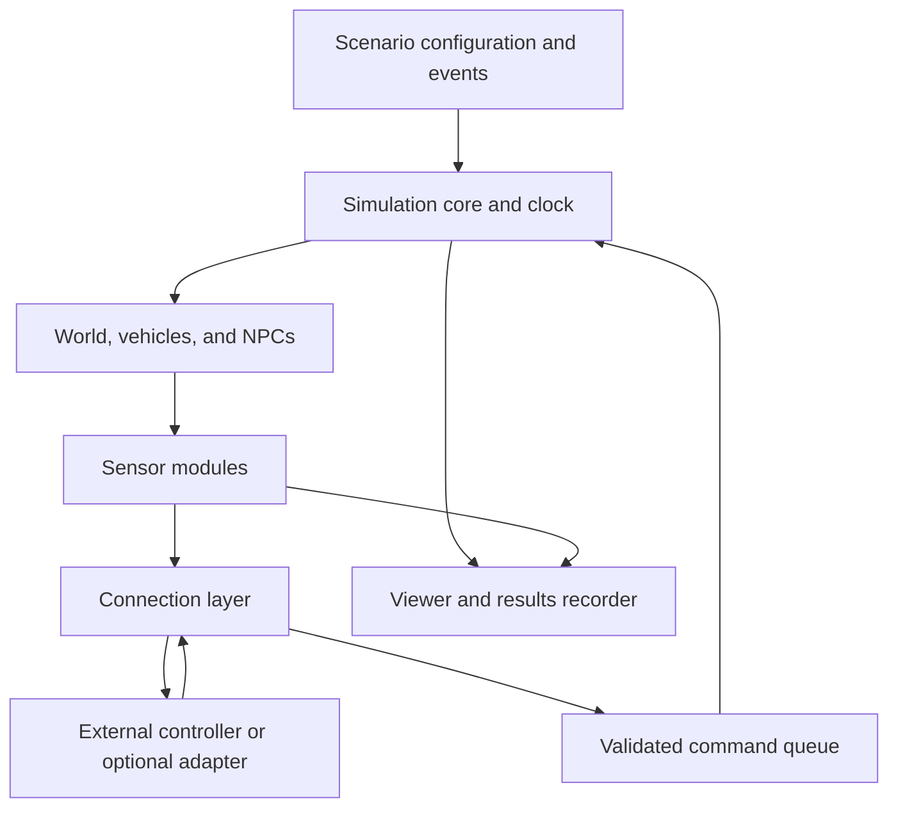

# Architecture

**Status:** Proposed design. Implementation and performance are not yet verified.

## Overview

Go-Car is a standalone Godot simulator with a fixed-step simulation core, replaceable sensor modules, and optional external connections. GDScript is the initial implementation language. The viewer displays simulation state; it does not advance the experiment clock or own vehicle state.

## Modules

| Module | Responsibility |
|---|---|
| **Simulation core** | Own time, fixed steps, vehicle IDs, command application, pause, step, and reset |
| **World and actors** | Maintain geometry, vehicle motion, collisions, and scripted NPC behaviour |
| **Sensors** | Sample vehicle/world state on their schedules; apply configured noise and faults; emit measurements |
| **Scenario manager** | Load initial conditions, schedule events, manage fault actions, and evaluate assertions |
| **Connection layer** | Validate and exchange telemetry/commands; handle routing and bounded queues |
| **Viewer** | Present state and sensor overlays; submit user actions through the same control interfaces |
| **Results recorder** | Record configuration, events, measurements, timing, and pass/fail outcomes |

## Execution and timing

At each simulation step: apply due scenario events and accepted commands, advance actors, sample due sensors, then evaluate assertions and record outputs. The precise ordering is versioned as part of the experiment contract.

Rendering, sensor sampling, and telemetry use separate schedules. Network callbacks enqueue commands rather than modifying world state directly. Commands are applied at a simulation boundary and recorded with their source and application frame. Pause freezes simulation time; single-step advances one fixed interval.

Seeded randomness supports repeatable offline scenarios. Live external controllers introduce wall-clock timing variation, so their latency and command arrival frames must be recorded. Fixed steps alone do not guarantee identical distributed runs.

## Extension boundaries

- **Sensors:** a common configure/sample/fault/reset lifecycle, IDs, mounting information, and timestamped outputs. New sensors register through the extension mechanism and use documented world queries without changing the core loop.
- **External systems:** a versioned, technology-neutral WebSocket contract initially; a Python example client. Other protocols and middleware connect through optional adapters outside the core.
- **Scenarios:** JSON defines actors, sensors, events, and assertions. Validate configuration before starting a run.
- **Presentation:** headless runs omit the viewer. Low-poly 3D later reuses contracts and experiment tooling while adding the necessary 3D world and sensor implementations.

## Lightweight and reliable operation

Instantiate only selected modules. Disabled sensors perform no normal sampling work. Keep visual meshes separate from collision and sensor geometry where needed, without discarding geometry relevant to an experiment. Bound communication buffers and log queues; report overflow or dropped data explicitly. Record invalid commands and reject unknown vehicle IDs.

Standalone operation requires no external middleware, database server, or integration service. Performance claims require benchmarks, and model simplifications require documented validation tolerances.

See [interfaces](interfaces.md) for message and sensor contracts, [scope and requirements](scope-and-requirements.md) for acceptance criteria, and [roadmap](roadmap.md) for implementation order. The interfaces document is planned until added.
